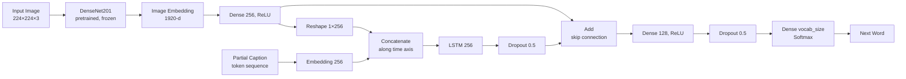

#  Image Caption Generator using CNN + LSTM

An end-to-end deep learning project that looks at an image and writes a natural-language sentence describing it. A pretrained **DenseNet201** CNN encodes the image, an **LSTM** decoder generates the caption word by word, and a **Streamlit** web app lets anyone upload an image and get a caption.

Trained on the **Flickr8k** dataset.

---

##  Table of Contents
- [Overview](#-overview)
- [Demo](#-demo)
- [Architecture](#-architecture)
- [Dataset](#-dataset)
- [Pipeline](#-pipeline)
- [Training Details](#-training-details)
- [Project Structure](#-project-structure)
- [Installation & Usage](#-installation--usage)
- [Results & Observations](#-results--observations)
- [Future Work](#-future-work)
  


---

##  Overview

Image captioning sits at the intersection of **Computer Vision** and **Natural Language Processing**. This project follows the classic **encoder–decoder** framework:

| Component | Role |
|-----------|------|
| **Encoder (CNN)** | DenseNet201 (ImageNet-pretrained) turns each image into a 1920-dimensional feature vector |
| **Decoder (LSTM)** | Takes the image embedding + the words generated so far and predicts the next word |
| **Inference** | Greedy decoding, starting from `startseq` and stopping at `endseq` or the max caption length |
| **Deployment** | Streamlit app for uploading an image and viewing the generated caption |

---

##  Demo

Run the Streamlit app, upload a `.jpg`, `.jpeg` or `.png` image, and the model shows the image with its generated caption as the title.

<!-- Add your own screenshots here -->
<!--  -->

---

##  Architecture



**Key design choices**
- **Image features injected twice:** the projected image vector is fed as the *first timestep* of the LSTM input, and is also *added back* to the LSTM output (a residual-style merge), so visual context isn't lost by the time the decoder predicts.
- **Precomputed features:** DenseNet201 features are extracted once for all images and cached, which makes training much faster than running the CNN every epoch.
- **Custom data generator:** a Keras `Sequence` expands each caption into (image, partial-sequence → next-word) pairs batch by batch, so the full dataset never needs to fit in memory.

---

##  Dataset

- https://www.kaggle.com/datasets/adityajn105/flickr8k
- 8,091 images
- 5 human-written captions per image (~40K captions)
- `captions.txt` maps each image filename to its captions

**Split (by image, so no image leaks across sets):**
| Set | Share | Images |
|-----|-------|--------|
| Train | 85% | 6,877 |
| Validation | 15% | 1,214 |

---

##  Pipeline

### 1. Caption preprocessing
- Convert to lowercase
- Remove single-character words
- Strip extra whitespace
- Wrap every caption with `startseq` … `endseq` tokens

```
"A girl going into a wooden building ."
        ↓
"startseq girl going into wooden building endseq"
```

### 2. Tokenization
- Keras `Tokenizer` builds the vocabulary from all captions
- `vocab_size = len(word_index) + 1`
- `max_length` = length of the longest caption (used for padding)

### 3. Feature extraction
- DenseNet201 with the classification head removed (output of the Global Average Pooling layer)
- Images resized to 224×224 and scaled to [0, 1]
- Output: one **1920-d vector per image**

### 4. Training-pair generation
A single caption becomes multiple training samples:

| Image feature | Input sequence | Target word |
|---------------|----------------|-------------|
| 🖼️ | `startseq` | `girl` |
| 🖼️ | `startseq girl` | `going` |
| 🖼️ | `startseq girl going` | `into` |
| ... | ... | ... |
| 🖼️ | `startseq girl ... building` | `endseq` |

### 5. Inference (greedy decoding)
```
in_text = "startseq"
repeat up to max_length:
    predict next word from (image_features, in_text)
    append word to in_text
    stop if word == "endseq"
```

---

##  Training Details

| Hyperparameter | Value |
|----------------|-------|
| Optimizer | Adam (lr = 1e-3) |
| Loss | Categorical cross-entropy |
| Batch size | 64 images |
| Max epochs | 50 |
| Embedding / LSTM size | 256 |
| Dropout | 0.5 |

**Callbacks**
- `ModelCheckpoint`: saves the best model (lowest `val_loss`) as `model.keras`
- `EarlyStopping`: patience 5, restores the best weights
- `ReduceLROnPlateau`: factor 0.2, patience 3

**Outcome:** Early stopping triggered at **epoch 12**; best weights came from **epoch 7** with **validation loss ≈ 3.597**.

Training was done on Kaggle with GPU (~75 s per epoch; feature extraction for all 8,091 images took ~12 min).

---

##  Project Structure

```
Image-Caption-Generator-Using-Deep-Learning-Image-Captioning-Using-CNN-LSTM/
│
├── main.py                                            # Streamlit web app
├── flickr8k-image-captioning-using-cnns-lstms.ipynb   # Training notebook (Kaggle)
├── requirements.txt
├── README.md
│
└── models/
    ├── model.keras               # Trained caption model (CNN-LSTM decoder)
    ├── feature_extractor.keras   # DenseNet201 feature extractor
    └── tokenizer.pkl             # Fitted Keras tokenizer
```

>  The `.keras` model files are large. If they aren't in the repo, generate them by running the notebook, or download them from the link in the [Releases](../../releases) section, and place them in the `models/` folder.

---

##  Installation & Usage

### 1. Clone the repository
```bash
git clone https://github.com/<your-username>/Image-Caption-Generator-Using-Deep-Learning-Image-Captioning-Using-CNN-LSTM.git
cd Image-Caption-Generator-Using-Deep-Learning-Image-Captioning-Using-CNN-LSTM
```

### 2. Create a virtual environment (recommended)
```bash
python -m venv venv
# Windows
venv\Scripts\activate
# Linux / macOS
source venv/bin/activate
```

### 3. Install dependencies
```bash
pip install -r requirements.txt
```

### 4. Add the trained models
Place `model.keras`, `feature_extractor.keras` and `tokenizer.pkl` inside the `models/` folder.

### 5. Run the app
```bash
streamlit run main.py
```
Open `http://localhost:8501` in your browser, upload an image, and see the generated caption.

### Training from scratch
1. Open the notebook on [Kaggle](https://www.kaggle.com/) and attach the Flickr8k dataset
2. Enable GPU
3. Run all cells; this produces `model.keras`, `feature_extractor.keras` and `tokenizer.pkl`

---

##  Results & Observations

- The model generates grammatically reasonable captions that capture the main objects and actions in an image (e.g. dogs, children, people playing).
- The learning curve shows **overfitting**: training loss keeps dropping while validation loss plateaus around 3.6 after a few epochs. This is expected given Flickr8k's small size.
- Greedy decoding sometimes produces generic or repetitive captions.

---

##  Future Work

- [ ] Train on a larger dataset (**Flickr30k** / **MS-COCO**)
- [ ] Add an **attention mechanism** (Show, Attend and Tell) so the decoder can focus on image regions
- [ ] Use **beam search** instead of greedy decoding
- [ ] Report **BLEU / METEOR / CIDEr** scores on the validation set
- [ ] Try **Transformer-based decoders** or vision-language models (e.g. ViT + GPT-2, BLIP)
- [ ] Use pretrained word embeddings (GloVe)
- [ ] Deploy the app on Streamlit Cloud / Hugging Face Spaces

---


- **Deep learning:** TensorFlow / Keras
- **Pretrained CNN:** DenseNet201 (ImageNet)
- **Data handling:** NumPy, Pandas
- **Visualization:** Matplotlib, Seaborn
- **Web app:** Streamlit

---


